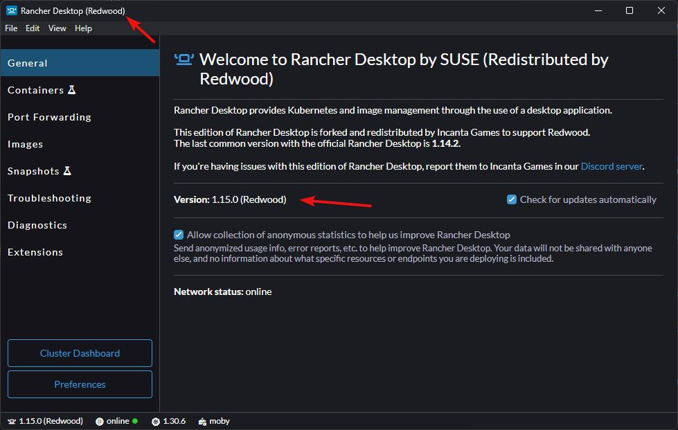

import Tabs from '@theme/Tabs';
import TabItem from '@theme/TabItem';

# Deploying Locally

:::danger
Make sure you have a Redwood-specific version of Rancher Desktop; it will have `(Redwood)` listed in the title and versions. If you don't have these, you'll need to follow the [steps on uninstalling the current version and installing the new version](./prerequisites.md#rancher-desktop).

<details>
    <summary>How to check if you have the Redwood version</summary>

    
</details>
:::

Deploying Redwood uses the provided [Infrastructure-as-Code (IaC)](https://learn.microsoft.com/devops/deliver/what-is-infrastructure-as-code); the same workflow is used to deploy to a local development [Kubernetes](https://kubernetes.io/) cluster as well as production ones.

If you installed all of the [prerequisites](./prerequisites.md) properly, you're ready to test deploying the Redwood backend to your local Kubernetes cluster (which Rancher Desktop hosts within WSL). Altogether, this setup gives us a Linux environment that has Docker and Kubernetes, which is very similar to what [deploying to a cloud provider](./deploying-remotely.md) would look like.

## Redwood Configuration

While it's not strictly required to set up a new configuration environment just to get started, it will be convenient to have it when you inevitably want to change something.

1. Create a new folder next to the config environment you created in [Getting Started](../getting-started/installing.md#initial-configuration) for the Kubernetes dev environment (e.g. `project-name-k8s`; k8s is a common abbreviation for Kubernetes)
1. Create a `_config.json` file in that folder (e.g. `project-name-k8s/_config.json`) with the `parentNames` pointing to the provided `kubernetes` environment **and** the environment folder you created earlier.

    **For example:**

    ```json
    {
      "parentNames": ["kubernetes", "project-name"]
    }
    ```

    :::warning
    The order matters! The config system reads these environments in order, overriding variables that were previously read in. You need to have `kubernetes` before your config env as shown above.
    :::

    :::note
    You might have started to notice the inheritance pattern we've been introducing for configuration. In our examples, the config env `project-name-k8s` inherits from `project-name`. Later, when we [deploy to a cloud](./deploying-remotely.md#redwood-configuration), we'll introduce a config env `project-name-prod` that inherits from `project-name-k8s`. This pattern isn't required, but it can prevent issues where a config variable was added for development but not for production.

    You can read more about **[configuration inheritance here](../configuration/overview.md#config-environment-inheritance)**.
    :::

1. Don't set `game-servers.provider` in your base config environment (e.g. `project-name/realm/instances/default.yaml`). The `kubernetes` environment switches the `default` realm to the `agones` provider (and Open Match matchmaking), and your base environment is read after it, so an override there would switch Kubernetes back to the `local` provider. If you add more realms, set `game-servers.provider: "agones"` for them in this Kubernetes environment.

The `kubernetes` environment also switches the backend to PostgreSQL, Redis, and S3-compatible blob storage (SeaweedFS) running inside the cluster, enables [text chat](../features/social/text-chat.md), and routes the Director and Realm Frontends through an ingress on port `80`. You can see everything it changes in `config/node/kubernetes`.

### Standard License

:::caution Known issue (5.0.0)
The `standard` config environment doesn't override the images for the Director and Realm **gateway** services, so on Kubernetes they try to use a `-dev` image that the Standard License doesn't build. If you have a Standard License, add these overrides to your Kubernetes config environment (they match what the `staging` environment uses):

`project-name-k8s/director.yaml`:

```yaml
gateway:
  deployment:
    image: "${docker.image-prefix}-core-runner"
    command: ["/app/app", "director-gateway"]
```

`project-name-k8s/realm/_index.yaml`:

```yaml
deployment:
  gateway:
    image: "${docker.image-prefix}-core-runner"
    command: ["/app/app", "realm-gateway"]
```
:::

### Pulumi Configuration

Pulumi can run in different modes:
- Storing the Pulumi state locally
    - This is the default for easy onboarding, but you should consider other options for teams and nearing launch
- Storing in another [self-managed backend](https://www.pulumi.com/docs/iac/concepts/state-and-backends/#using-a-self-managed-backend) (e.g. S3, Azure Blob Storage, or Google Cloud Storage)
- Storing the Pulumi state in an instance of [Pulumi Cloud](https://www.pulumi.com/product/pulumi-cloud/)

:::info
By default, Redwood is configured to store the Pulumi state locally, which is just fine when you're getting started. You may want to consider switching to Pulumi Cloud (you can self-host or use Pulumi's managed service that's [very affordable with a great free tier](https://www.pulumi.com/pricing/)). We prefer Pulumi Cloud over the other self-managed options like S3 due to the better integration and auditable records. Either way, having a shareable backend state is critical for teams, and it ensures your Pulumi deployment state isn't lost if a personal computer is.
:::

1. In the folder you created above, create a `deployment/pulumi.yaml` file (e.g. `project-name-k8s/deployment/pulumi.yaml`) with the contents:

    ```yaml
    project: "<project-name>"
    ```

    **For example:**

    ```yaml
    project: "project-name"
    ```

    :::note
    If you're using Pulumi Cloud, you'll also need to add to the file:

    ```yaml
    local-mode: false
    org: "<pulumi-org-name>"
    access-token: "<your-pulumi-access-token>"
    ```

    Redwood is pre-configured to work with Pulumi's managed service when `local-mode` is `false`, but if you are **self-hosting** Pulumi Cloud, you can also change the URL to your Pulumi Cloud instance:

    ```yaml
    url: "https://yourpulumicloud.com"
    ```

    The access token supports the [secrets system](../features/secrets/overview.md). See the [deployment config reference](../configuration/reference/deployment.md) for every Pulumi option.
    :::

    :::note
    Some IDEs (e.g. VS Code) will report that `pulumi.yaml` has a syntax error because they apply the schema Pulumi uses for its own files named `pulumi.yaml`. You can prevent this, at least in VS Code, by adding this line to the top of the file:

    ```yaml
    # yaml-language-server: $schema=./pulumi.yaml
    ```
    :::

## Deploying

Deploying locally for basic configurations is fairly straightforward:

1. Ensure Rancher Desktop is running
1. Open a terminal to the `RedwoodBackend` directory
1. Install the Node.js dependencies by running the below command (if you haven't already):

    ```bash
    yarn
    ```

    :::note
    `yarn` will automatically trigger a build, but you can recompile manually by running `yarn build`.
    :::

1. <a id="game-server-image"></a>Make sure the Linux [sidecar](../architecture/overview.md#sidecar) binary exists at `RedwoodBackend/dist/linux-microservices/sidecar`. The game server image bundles it next to your Unreal server.

    <Tabs>
      <TabItem value="standard" label="Standard License" default>
        It's included in the backend download; there's nothing to do.
      </TabItem>
      <TabItem value="custom" label="Custom License">
        Package it from source:

        ```bash
        yarn pkg:sidecar
        ```
      </TabItem>
    </Tabs>

1. Copy your [packaged Linux server](./packaging.md#linux-server) into `RedwoodBackend/dist/game-servers/LinuxServer` (create the folders if they don't exist). The folder name comes from the realm's `game-servers.local-dir` config variable; see [Copying the Server to the Backend](./packaging.md#copying-the-server-to-the-backend).

1. Deploy the Redwood backend by running the below command:

    ```bash
    yarn deploy <config-environment>
    ```

    Where `<config-environment>` is the [folder you created above](#redwood-configuration) (e.g. `project-name-k8s`).

    This command will do the following:

    1. Build the necessary Docker images (the backend services and your game server)
    1. Deploy the necessary dependencies to the local Kubernetes cluster (see [Dependencies](#dependencies))
    1. Deploy the Redwood services to the local Kubernetes cluster

    :::note
    Docker images are not automatically built by `yarn deploy` if you're inheriting from the `staging` or `production` configuration environments (they set `docker.build-in-pulumi: false`). You will need to use the `yarn docker` command beforehand to create them. You can read more about this in [**Deploying Remotely**](./deploying-remotely.md#building-and-pushing-docker-images).
    :::

1. You may be prompted to create the configured Pulumi stack. By default the stack is `dev`, but you can override this in the [above `pulumi.yaml` file](#pulumi-configuration) with `stack: "<stack-name>"`. If the name of the stack looks right, press the `Enter` key.

1. Pulumi will start generating a preview of the deployment; no changes are made yet. It lists every resource it will create: the Docker images, Helm releases for the [dependencies](#dependencies), and for both the Director and each realm a set of ConfigMaps, Deployments/StatefulSets, Services, and Ingresses (plus an Agones Fleet and FleetAutoscaler for the game servers). You'll be prompted whether the proposed changes should be applied. Press the `Up` arrow to select `yes` and press the `Enter` key.

1. The deployment will be finished when the output stops changing and you see the final summary with the number of resources created and the duration. The first deploy takes a while since it builds images and installs every Helm chart; later deploys only change what's different.

### Deploy Options

`yarn deploy <config-environment>` accepts these options:

| Option | What it does |
| --- | --- |
| `-s`, `--skip-preview` | Skip the preview step (automatically skipped in CI) |
| `-y`, `--yes` | Skip confirmation prompts. This doesn't skip the preview; use `--skip-preview` for that. |
| `--migrate-db-without-confirmation` | Don't prompt before running database migrations. **All services are destroyed during a migration.** |
| `-c`, `--cancel` | Cancel an in-progress deployment (e.g. after a crash left the stack locked) |
| `-d`, `--destroy` | Destroy everything in the stack |
| `-r`, `--remove` | Remove the stack itself from Pulumi's state |
| `-v`, `--verbosity <level>` | Log level (default `info`; `trace` prints all of Pulumi's output) |

Before deploying, `yarn deploy` also runs the [default secrets check](./deploying-remotely.md#default-secrets-check) if your environment enables it (it's off for local environments by default).

### Dependencies

These third-party Helm charts are installed into the cluster (the versions are from `config/node/default/deployment/dependencies`, and each chart's `values` can be overridden in your config environment):

| Dependency | Chart version | Namespace | Used for |
| --- | --- | --- | --- |
| [ingress-nginx](https://kubernetes.github.io/ingress-nginx) | `4.13.3` | `default` | Routing `director.localhost`, `realm-default.localhost`, and other hostnames to the right service |
| [Agones](https://agones.dev) | `1.53.0` | `agones-system` | Hosting game servers (when a realm uses the `agones` provider) |
| [Open Match](https://open-match.dev) (Redwood build) | `1.8.1` | `open-match` | [Matchmaking](../features/ticketing/matchmaking/open-match.md) |
| [PostgreSQL](https://github.com/bitnami/charts/tree/main/bitnami/postgresql) (Bitnami) | `12.12.10` (PostgreSQL 15) | `persistence` | Director and Realm databases (when not using an external database) |
| [Redis](https://github.com/bitnami/charts/tree/main/bitnami/redis) (Bitnami) | `20.13.4` | `persistence` | Pub/sub, ephemeral data, and job queues |
| [SeaweedFS](https://github.com/seaweedfs/seaweedfs) | `4.0.399` | `persistence` | S3-compatible [blob storage](../features/data/storage/blob-storage.md) |
| [metrics-server](https://github.com/kubernetes-sigs/metrics-server) | `3.13.0` | `metrics-server` | Resource metrics (enabled in `production`; Rancher Desktop provides its own) |
| Grafana agent operator / k8s monitoring | `0.3.8` / `0.2.11` | `observability` | Optional monitoring (disabled by default) |

The [text chat](../features/social/text-chat.md) server (ejabberd, image `redwoodmmo/ejabberd:25.10`) is deployed when `chat.text.enabled` is `true`, which the `kubernetes` environment enables. All of these variables are in the [deployment config reference](../configuration/reference/deployment.md).

## Testing

### Hosts

When you're using Kubernetes to host the backend instead of the Dev Initiator, the services aren't reached on their own ports (`3001`, `3011`, etc.). Instead, everything goes through the ingress on port `80`, which uses the hostname to figure out which service a request is meant for. Your `hosts` file needs these entries (you likely added them in [Getting Started](../getting-started/installing.md#configure-hosts-file)):

```
127.0.0.1 director.localhost
127.0.0.1 realm-default.localhost
127.0.0.1 chat.localhost
```

`realm-default-backend.localhost` isn't used in Kubernetes; game servers reach the Realm Backend through its internal cluster address.

### Connection

The client needs to connect to the Director through the ingress, so change the `Director Uri` setting that the client connects to. You can do this in your UE project's **Project Settings** under **Redwood** in the **Plugins** section. Set `Director Uri` to:

```
ws://director.localhost
```

:::info
If you need to change the Director Uri setting for a packaged build, you don't need to repackage.

Create a file named `redwood.json` in the project folder of your packaged client (i.e. `path-to-packaged-build/Windows/YourProject/redwood.json`); this should be the same folder where you see the `Binaries` and `Content` folders. Set the contents of the file to:

```json
{
  "directorUri": "ws://director.localhost"
}
```

For builds you ship to players, you can disable this override with the **Redwood Json Enabled** project setting, or require the file to be signed by setting a **Public Signing Key** and signing the file with `yarn sign-redwood-json`. See the [settings reference](../unreal-reference/settings.md).
:::

### Running a Test

Testing the backend in a Kubernetes environment (locally or [remotely](./deploying-remotely.md)) works the same way as testing with the Dev Initiator; only the Director Uri changes.

- **Match-based games:** run your client and use matchmaking (a profile with `matchmaking-zone-name`) or create/join a lobby. Agones allocates a game server from the fleet and the client travels there automatically.
- **Persistent worlds:** create the world's [GameServerProxy](../architecture/game-servers.md#gameserverproxy) first, just like in [Running with the Backend](../getting-started/running-with-backend.md), using the [CLI](../features/cli.md) with your Kubernetes config environment:

    ```bash
    yarn cli create-proxy <profile-id> <proxy-name> --env project-name-k8s --start-on-boot
    ```

    You can also have the realm create it automatically with the [default proxy](../features/realms.md#default-proxy) settings. Then join it from the client (e.g. **List Proxies** and **Join Queue**).

The CLI connects to the Director through `director.localhost`, so the hosts entries above are needed on the machine running the CLI.

:::tip
You can watch what's happening in the cluster with `kubectl` (e.g. `kubectl get pods -A` and `kubectl logs -n realm-default <pod-name>`), or with any Kubernetes UI that reads your kubeconfig (Rancher Desktop includes one). Game servers run in the realm's namespace (`realm-default` by default).
:::

## Deploying Remotely

:::success
You now have a local Kubernetes cluster that hosts the same microservices that get deployed to a production environment in the cloud. Most of your development and testing will be done locally, but it's important to test deploying to the cloud well before it's time to release your game.

Whenever you're ready to test deploying to the cloud, you can read more about it **[here](./deploying-remotely.md)**.
:::
