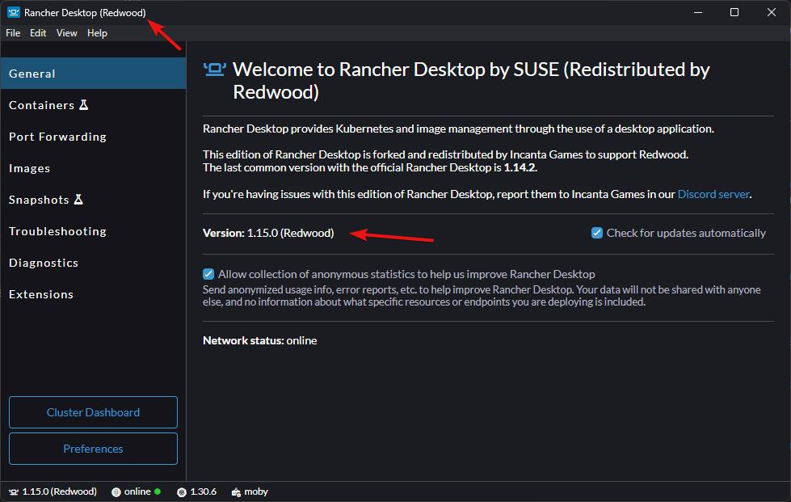

# Kubernetes Prerequisites

:::danger
Please follow all of the steps in the [**Getting Started**](../getting-started/overview.md) section before deploying to Kubernetes. This section assumes you've done those steps, which include extra setup.
:::

The prerequisites you installed when you got started let you run Redwood without Kubernetes (via the Dev Initiator). To deploy to a Kubernetes cluster you need a few more things. Deploying to Kubernetes is **required for deploying to the cloud**, but it's also useful for testing a production-like environment locally before deploying to the cloud.

- [Compile Unreal from Source](#compile-unreal-from-source)
- [Pulumi Infrastructure as Code (IaC)](#pulumi)
- [Windows Subsystem for Linux (WSL)](#wsl)
- [Rancher Desktop](#rancher-desktop)

## Compile Unreal from Source

The version of Unreal Engine that you download from the Epic Games Launcher can't build the `Server` target used to package dedicated servers, which is necessary for deploying to Kubernetes. You'll also need the Linux cross-compile toolchain since the game servers run in Linux containers (see [Packaging](./packaging.md#linux-server)).

**Unreal has a great [guide on building Unreal from source for each OS](https://dev.epicgames.com/documentation/unreal-engine/building-unreal-engine-from-source).** Redwood supports Unreal Engine 5.4 and newer.

## Pulumi

There are multiple frameworks to define IaC; we use [Pulumi](https://www.pulumi.com/). Pulumi allows us to write the IaC in Node.js/TypeScript instead of having to learn a declarative scripting language, and Redwood's deployment scripts (`yarn deploy`) are a Pulumi program.

Pulumi needs somewhere to store the state of what's been deployed so it can determine which changes are necessary on the next deploy. You have a few options:

| Option | When to use it | Config |
| --- | --- | --- |
| **Local state** (default) | Getting started, solo developers, local clusters. The state is stored on your machine in `~/.pulumi` and isn't shared with anyone. | `deployment.pulumi.local-mode: true` (the default) |
| **Pulumi Cloud** | Teams where multiple people deploy. [pulumi.com](https://www.pulumi.com/) has a fairly comprehensive free tier, or you can [self-host](https://www.pulumi.com/product/self-hosted/). | `local-mode: false`, `url`, `access-token`, and `org` |
| **Object storage** (S3, GCS, Azure Blob) | Teams that want shared state without Pulumi Cloud | `local-mode: false` and `url` set to the [backend URL](https://www.pulumi.com/docs/cli/commands/pulumi_login/) |

Redwood logs into the configured state backend for you, so you don't need to run `pulumi login` yourself. When using local state, the Pulumi organization name is always `organization`. All of the Pulumi options are listed in the [deployment config reference](../configuration/reference/deployment.md).

1. [Install the Pulumi CLI](https://www.pulumi.com/docs/install/)
1. Optionally, [create a Pulumi Cloud account](https://app.pulumi.com/signup) and [create or join an Organization](https://www.pulumi.com/docs/pulumi-cloud/organizations/#creating-an-organization). You can start with local state and switch later.

## WSL

:::note
This is only required for deploying to a local Kubernetes cluster on a Windows machine. We recommend testing locally before deploying to the cloud, but this step could be skipped if you're only deploying to the cloud.
:::

WSL, or Windows Subsystem for Linux, is an extra runtime that runs Linux simultaneously in the background as you run Windows. We use this to replicate the production environment for the backend closely, and it makes development much simpler.

Please follow the [official Microsoft guide](https://learn.microsoft.com/windows/wsl/install) on how to install WSL. The Linux distribution you install doesn't matter; we use the default (Ubuntu).

## Rancher Desktop

:::note
This is only required for deploying to a local Kubernetes cluster on a Windows machine. We recommend testing locally before deploying to the cloud, but this step could be skipped if you're only deploying to the cloud.
:::

:::danger
If you already have the official Rancher Desktop installed, you will need to [**properly uninstall it**](https://docs.rancherdesktop.io/faq/#q-how-can-i-downgrade-rancher-desktop-to-a-non-current-older-release-version) and install the Redwood version following the steps in this section. Redwood versions have `(Redwood)` in the title and the version numbers.

    
How to check if you have the Redwood version

    

:::

Rancher Desktop (not to be confused with Rancher) is an easy to use tool that provides Docker and Kubernetes to the WSL environment. We use Docker to create containers of each backend service, which we then run in a Kubernetes cluster. It's okay if these terms are confusing; by design, Redwood handles getting things running in these more complicated environments so you can learn the subjects later if/when it's needed. Simply put, Rancher Desktop helps us replicate a scalable server environment for the backend.

1. If you need to uninstall a prior version of Rancher Desktop, follow [**these steps**](https://docs.rancherdesktop.io/faq/#q-how-can-i-downgrade-rancher-desktop-to-a-non-current-older-release-version)
1. Find the latest Redwood edition installer for Rancher Desktop at https://github.com/redwoodmmo/rancher-desktop/releases/latest.
1. Running Rancher Desktop for the first time will ask what version of Kubernetes and the Container Engine you want. We usually use the latest `(stable)` version and `dockerd (moby)` respectively.

:::info
Rancher Desktop doesn't start automatically with Windows unless you enable `Automatically start at login` in the Preferences, so you may have to run it manually after a reboot.
:::
