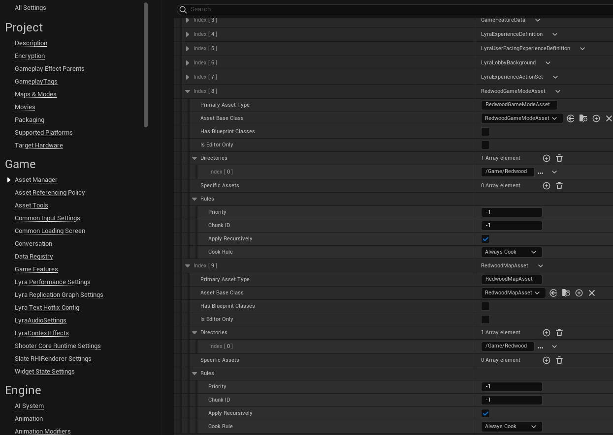
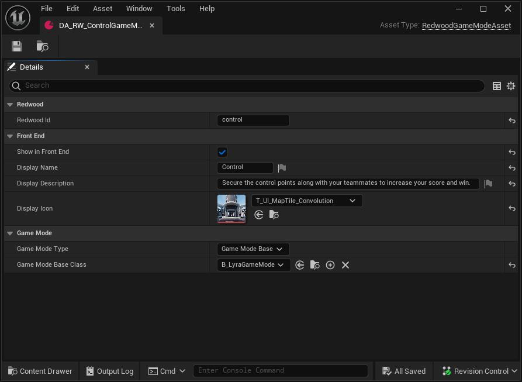
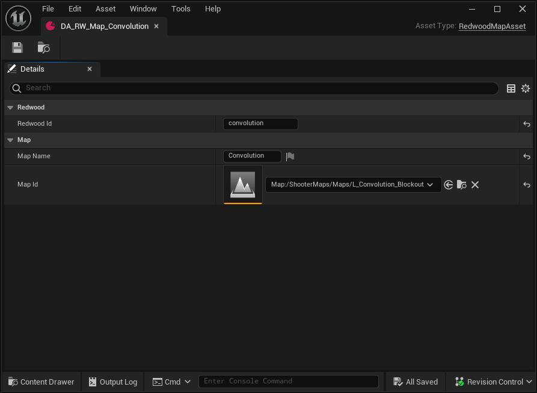

import Tabs from '@theme/Tabs';
import TabItem from '@theme/TabItem';

# Defining Game Modes and Maps for Redwood

Both Unreal and the Backend need to know which game modes and maps exist, and they need to agree on their IDs. Without these being properly configured and synchronized, the backend can't tell a game server what to load and your match or world won't start.

Here's how the pieces line up:

| Backend (`game.yaml`) | Unreal |
| --- | --- |
| A profile's `id` (e.g. `deathmatch`) | The **Redwood Id** of a `URedwoodGameModeAsset`, which points at your game mode class |
| A map name in a zone's `maps` (e.g. `arena`) | The **Redwood Id** of a `URedwoodMapAsset`, which points at your level |

When a game server starts, it boots into your project's **Server Default Map** and waits. The backend then tells it which mode ID and map ID to load; the Redwood plugin looks up the matching Data Assets and opens the level with your game mode (`open <level>?game=<game mode class>?...`).

## Unreal

Redwood defines two `UDataAsset` types that are **required** for your game to work with Redwood, and a third for sync items:

- [`URedwoodGameModeAsset`](#game-mode-asset)
- [`URedwoodMapAsset`](#map-asset)
- `URedwoodSyncItemAsset`, only needed if you use [Sync Items](../features/sync-items.md) or [World Data](../features/data/game/world-data.md)

These serve a few functions:

- Provide synchronized IDs with the `game.profiles` backend configuration for Game Modes and Maps
- Link the ID with the respective Unreal asset
- Provide any user-friendly information for display in your menus
- Enable a standardized way for the Redwood server game subsystem to know how to change a map when the backend tells it to load a new mode/map

### Asset Manager Settings

Redwood finds these Data Assets through the Asset Manager, so you need to tell the Asset Manager where they are and make sure they're cooked.

:::danger
If the `RedwoodGameModeAsset` and `RedwoodMapAsset` types aren't registered, the server logs an error at startup and **never connects to the backend**, so the server never finishes starting.
:::

1. In the Unreal Editor, navigate to `Edit > Project Settings...`
1. Find **Asset Manager** under the **Game** section in the side panel
1. Under **Primary Asset Types to Scan**, add a new entry:
    - Set **Primary Asset Type** to `RedwoodGameModeAsset`
    - Set **Asset Base Class** to `RedwoodGameModeAsset`
    - Leave **Has Blueprint Classes** and **Is Editor Only** unchecked
    - Add an entry to the **Directories** and set it to where your data assets are located
    - Under **Rules** set the **Cook Rule** to `Always Cook`
1. Add another entry the same way with **Primary Asset Type** and **Asset Base Class** set to `RedwoodMapAsset`
1. If you use sync items or world data, add a third entry for `RedwoodSyncItemAsset`



The **Primary Asset Type** must be spelled exactly as shown (it's the class name without the `U` prefix). If you'd rather edit `Config/DefaultGame.ini` directly, these are the equivalent lines (change the `Path` to your folder):

```ini
[/Script/Engine.AssetManagerSettings]
+PrimaryAssetTypesToScan=(PrimaryAssetType="RedwoodGameModeAsset",AssetBaseClass="/Script/Redwood.RedwoodGameModeAsset",bHasBlueprintClasses=False,bIsEditorOnly=False,Directories=((Path="/Game/Redwood")),SpecificAssets=,Rules=(Priority=-1,ChunkId=-1,bApplyRecursively=True,CookRule=AlwaysCook))
+PrimaryAssetTypesToScan=(PrimaryAssetType="RedwoodMapAsset",AssetBaseClass="/Script/Redwood.RedwoodMapAsset",bHasBlueprintClasses=False,bIsEditorOnly=False,Directories=((Path="/Game/Redwood")),SpecificAssets=,Rules=(Priority=-1,ChunkId=-1,bApplyRecursively=True,CookRule=AlwaysCook))
+PrimaryAssetTypesToScan=(PrimaryAssetType="RedwoodSyncItemAsset",AssetBaseClass="/Script/Redwood.RedwoodSyncItemAsset",bHasBlueprintClasses=False,bIsEditorOnly=False,Directories=((Path="/Game/Redwood")),SpecificAssets=,Rules=(Priority=-1,ChunkId=-1,bApplyRecursively=True,CookRule=AlwaysCook))
```

The **Map Id** picker in `URedwoodMapAsset` lists assets of the engine's `Map` primary asset type, which Unreal scans in `/Game/Maps` by default. If your levels live elsewhere, add their folder to the existing `Map` entry in **Primary Asset Types to Scan**.

:::warning
The Data Assets being cooked doesn't make the **levels** they point to cooked. When you package, make sure every level referenced by a `URedwoodMapAsset` is cooked, along with your Server Default Map and Game Default Map. The simplest way is **Project Settings > Packaging > List of maps to include in a packaged build**. See [Packaging](../deploying-to-kubernetes/packaging.md).
:::

### Game Mode Asset

Create an instance of `URedwoodGameModeAsset` (**right-click in the Content Browser > Miscellaneous > Data Asset**, then pick `RedwoodGameModeAsset`) for each game profile you define in the backend.

| Property | What it's for |
| --- | --- |
| **Redwood Id** | Must equal the backend profile's `id`. Lowercase with no spaces is a good convention (e.g. `deathmatch`, `overworld`). Unique per asset; assets with an empty Redwood Id are ignored. |
| **Show in Front End**, **Display Name**, **Display Description**, **Display Icon** | Not used by Redwood. Convenience fields for your menus, e.g. listing the modes a player can pick when creating a lobby. |
| **Game Mode Type** | Whether the game mode class inherits from `ARedwoodGameModeBase` (**Game Mode Base**) or `ARedwoodGameMode` (**Game Mode**). |
| **Game Mode Base Class** / **Game Mode Class** | The game mode class to use; which field shows depends on **Game Mode Type**. Only subclasses of the Redwood game mode classes can be picked. |



You can point several game mode assets at the same game mode class (e.g. an `overworld` and a `dungeon` profile can share one class if your logic handles both).

### Map Asset

Create an instance of `URedwoodMapAsset` for each level you reference in a zone's `maps` list.

| Property | What it's for |
| --- | --- |
| **Redwood Id** | Must equal the map name used in the backend profile's `zones.<zone>.maps`. Lowercase with no spaces is a good convention. Unique per asset. |
| **Map Name** | Not used by Redwood. A user-friendly name for your menus. |
| **Map Id** | The persistent level to load. |



### Sync Item Asset

`URedwoodSyncItemAsset` tells Redwood which actor class to spawn for a type of [Sync Item](../features/sync-items.md):

| Property | What it's for |
| --- | --- |
| **Redwood Type Id** | A unique ID for the sync item type (e.g. `community-chest`). `proxy` is reserved for the [World Data](../features/data/game/world-data.md) asset. |
| **Actor Class** | The actor class to spawn (it must be exactly this class, not a child class). Can be empty for the `proxy` asset, since world data lives on the game state. |

## Backend

### Profiles

The Redwood Backend configures the Game Modes and Maps under the `game.profiles` config variable in your config environment's `game.yaml`. This variable is an array of game profiles. Each profile has one or more **zones**, and each zone has one or more maps. You can use the same map in multiple zones and multiple profiles.

:::warning
`game.profiles` is a list, so yours **replaces** the default list (which only has an example `match` profile). Include every profile your game uses.
:::

Here are the variables for each item in the array (the [Game config reference](./reference/game.md#profiles) has the full details):

- `id` is a unique identifier that Redwood uses to keep track of each profile; it's also used as `Redwood Id` in the Unreal [Game Mode DataAsset](#game-mode-asset)
- `zones` is an object, containing a named object for each zone
  - `variableCasing: "original"` prevents unwanted transformation by our config system to ensure that `zone-name` stays as `zone-name` (and not transformed to `zoneName`). Because of it, the fields inside each zone must be written in camelCase.
  - `<zone-name>`
    - `maps` is an array of strings where each string associates with the corresponding `Redwood Id` variable you defined in the corresponding `URedwoodMapAsset`. A map will be randomly selected from this array.
    - `syncItemsFromAllZones` is optional. If set to true, all items from all zones will be synced to this zone.
    - `syncItemsFromZones` is optional. If set, all items from the specified zones will be synced to this zone.
    - `gameServers` is optional and overrides the game server provider for this zone (see [overrides](./reference/game.md#per-profile-and-per-zone-game-server-overrides)).
- `max-players-per-shard` is the maximum amount of players for a single game server instance (aka shard). It also serves as the maximum number of players that are allowed for matchmaking to consider a full match.
- `num-players-to-add-shard` is the number of players per zone per shard to choose to add another shard for the zone. Not setting/setting to null will disable [sharding](../features/game-servers/sharding.md).
- `num-minutes-to-destroy-empty-shard` Set this variable if you want empty shards to be destroyed after so many minutes of remaining empty. If you want to try to incentivize players to move from low-population shards to medium-population shards to be more efficient with server costs, you'll need to implement additional game and/or backend logic.
- `min-players-for-matchmaking` is the minimum number of players that are allowed for matchmaking to consider a potential shallow match.
- `matchmaking-zone-name` is an optional field that is required to enable matchmaking for this profile. Matchmaking requires a single-zone [`GameServerProxy`](../architecture/game-servers.md#gameserverproxy) so this field indicates which of the `zones` to use for matchmaking.
- `collection-ends-when-any-shard-ends` is a boolean that when `true` Redwood will shutdown all [`GameServerInstances`](../architecture/game-servers.md#gameserverinstance) in the associated [`GameServerCollection`](../architecture/game-servers.md#gameservercollection) if any of the `GameServerInstances` end. Set it to `false` for multi-zone persistent worlds.
- `parent-profile-id` is optional. It makes proxies of this profile children of the active proxy of another profile (e.g. an instanced dungeon whose parent is the overworld); the game server receives the parent's proxy ID so it can send players back.
- `data` is a key/value pair object where each pair will be passed to the map load URL as a parameter (e.g. `?key=value`). The value must be a string. Keys are converted to camelCase.
- `game-servers` is optional and overrides the realm's game server provider for this profile.

Here are some examples of `<config-environment>/game.yaml`:

<Tabs>
  <TabItem value="match" label="Match-based game" default>
    Players use matchmaking or lobbies to join short-lived matches.

    ``` yaml
    profiles:
      - id: "deathmatch"

        zones:
          variableCasing: "original"
          main:
            maps:
              - "arena"

        max-players-per-shard: 16

        matchmaking-zone-name: "main"
        min-players-for-matchmaking: 1

        collection-ends-when-any-shard-ends: true

        data:
          ScoreLimit: "25"

      - id: "capture-the-flag"

        zones:
          variableCasing: "original"
          main:
            maps:
              - "canyon"
              - "fortress"

        max-players-per-shard: 12

        matchmaking-zone-name: "main"
        min-players-for-matchmaking: 4
    ```
  </TabItem>
  <TabItem value="persistent" label="Persistent world">
    A long-running world split into zones, with shards added as the population grows, plus an instanced dungeon players can matchmake into.

    ``` yaml
    profiles:
      - id: "overworld"

        zones:
          variableCasing: "original"
          town:
            maps:
              - "overworld"
            syncItemsFromZones:
              - "wilds"
          wilds:
            maps:
              - "overworld"
          cave:
            maps:
              - "cave"

        max-players-per-shard: 50

        num-players-to-add-shard: 40
        # num-minutes-to-destroy-empty-shard: 5
        collection-ends-when-any-shard-ends: false

      - id: "dungeon"

        zones:
          variableCasing: "original"
          main:
            maps:
              - "dungeon"

        max-players-per-shard: 5

        matchmaking-zone-name: "main"
        min-players-for-matchmaking: 1

        parent-profile-id: "overworld"
    ```

    In this example, `town` and `wilds` share the `overworld` level; each zone's server only simulates its own area, and [zone spawns](../features/game-servers/zones.md) and zone transfers move players between them.
  </TabItem>
</Tabs>

### Shard Names / Max Shards Per Zone

The `game.shard-names` is a list of names to use for shards. When a shard is created, it will pick the first name from this list that is not already in use. If no names are available, it will not be created, so make sure you have enough names for the max number of shards you want to support. Redefining this variable will override the whole list. The first name in the list is the zone's main shard, which always stays up.

The configured **maximum shards per zone** is equal to the length of this array.

This is the default value of `game.shard-names`:

``` yaml
shard-names:
  - "Alpha"
  - "Bravo"
  - "Charlie"
  - "Delta"
  - "Echo"
  - "Foxtrot"
  - "Golf"
  - "Hotel"
  - "India"
  - "Juliet"
  - "Kilo"
  - "Lima"
  - "Mike"
  - "November"
  - "Oscar"
  - "Papa"
  - "Quebec"
  - "Romeo"
  - "Sierra"
  - "Tango"
  - "Uniform"
  - "Victor"
  - "Whiskey"
  - "Xray"
  - "Yankee"
  - "Zulu"
```
