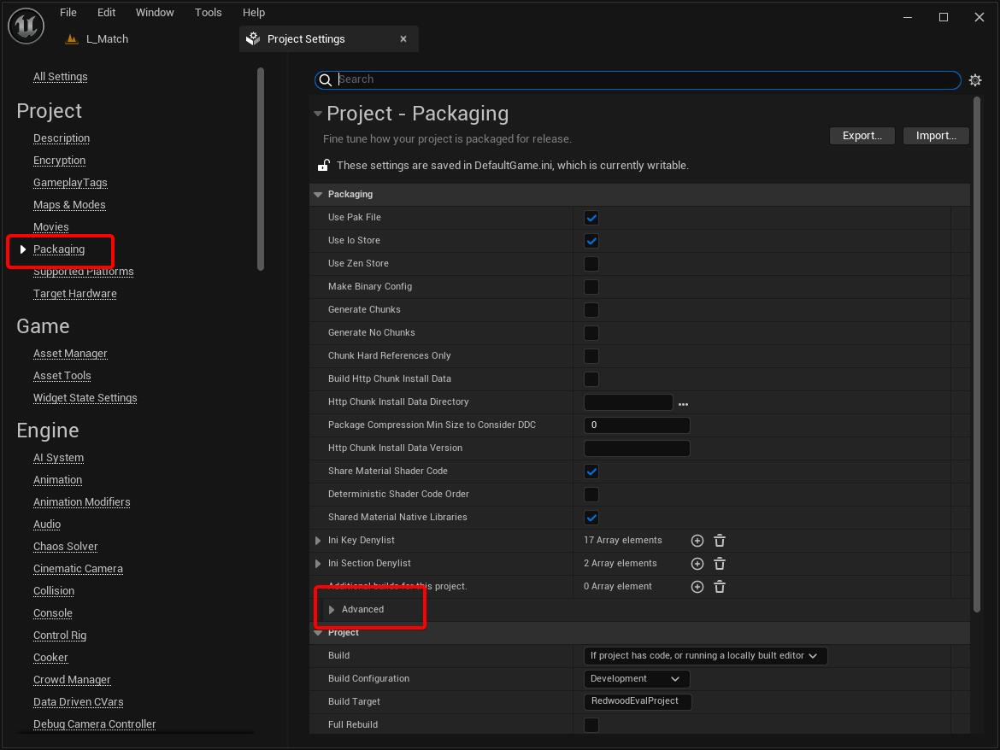
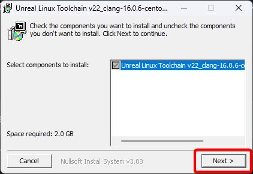
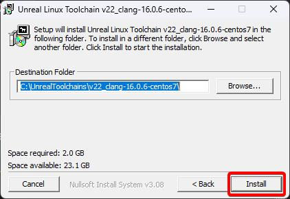
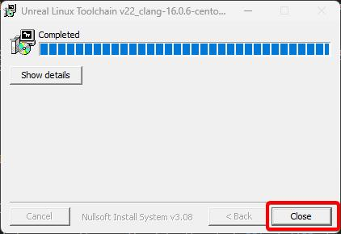
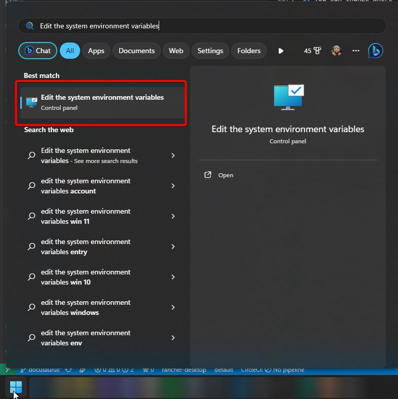
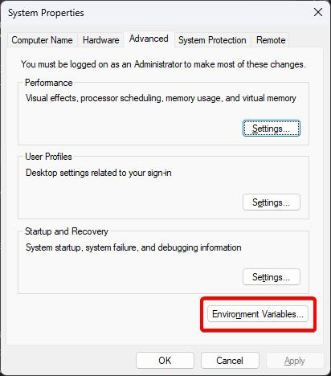
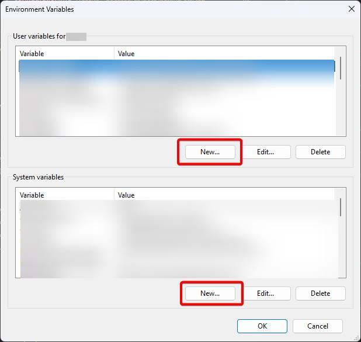
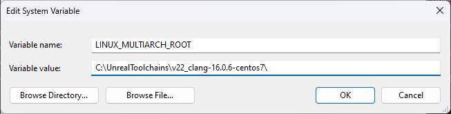
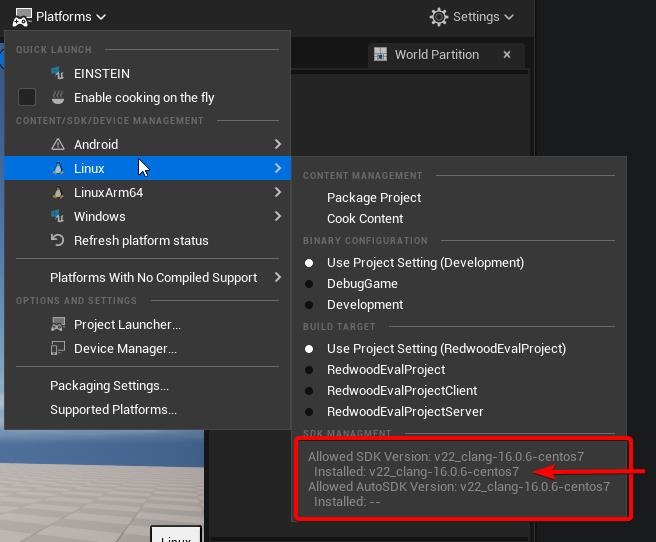

# Packaging

At a minimum, we need a packaged **Linux dedicated server** to deploy along with the backend. You can test against it with PIE (using the **Play Standalone** net mode with **Use Backend in PIE** enabled, just like in [Running with the Backend](../getting-started/running-with-backend.md)), but we'll package a client build as well in this guide since that's what your players will run.

:::note
This guide shows you how to package both client and dedicated server builds from within the Unreal Editor; you can automate this task with scripts (e.g. `RunUAT BuildCookRun`), but that is not covered here.
:::

## Before You Package

Packaging a Redwood game needs a few things that a single-player project doesn't. If you followed [Setting Up Unreal](../getting-started/setting-up-unreal.md), you've already done most of these; this is the checklist:

| Requirement | Why | Where it's covered |
| --- | --- | --- |
| A C++ project with `<Project>Server.Target.cs` and `<Project>Client.Target.cs` | Dedicated servers need a `Server` target; the `Client` target excludes server code from the build you ship to players | [Build Targets](../getting-started/setting-up-unreal.md#build-targets) |
| An Unreal source build | The Epic Games Launcher build can't package `Server` targets | [Prerequisites](./prerequisites.md#compile-unreal-from-source) |
| The Asset Manager scanning `RedwoodGameModeAsset`, `RedwoodMapAsset`, and `RedwoodSyncItemAsset` with **Always Cook** | The server looks these up when the backend tells it which game mode and map to load. Without them, the server never connects to its sidecar | [Asset Manager](../getting-started/setting-up-unreal.md#asset-manager) |
| An empty idle map as the **Server Default Map** | Servers boot into it and wait for the backend to tell them which map to load | [Maps](../getting-started/setting-up-unreal.md#maps) and [Default Maps](#default-maps) below |
| Every map referenced by your `RedwoodMapAsset` assets in the packaged build | Cooking the Data Assets does **not** cook the levels they point to | [Packaging Maps](#packaging-maps) below |

## Packaging Settings

### Default Maps

When you package for a dedicated server, you almost always need a different default map than the client.

1. Open up the **Project Settings** (**Edit** > **Project Settings**)
1. Under the **Project** section, go to **Maps & Modes**
1. You'll see a section called **Default Maps**; expand the **Advanced** subsection
1. Now you can see both the **Game Default Map** and the **Server Default Map**. The former is used for the client builds and the latter is used for the dedicated server builds.

    - Set the **Game Default Map** to your splash screen or title screen level (e.g. `L_Title`).
    - Set the **Server Default Map** to an empty level (e.g. `L_Empty`) with a plain (non-Redwood) game mode in its World Settings.

    The empty server map ensures your gameplay level doesn't get loaded until it's needed, which reduces wasted RAM and CPU usage when keeping warm servers (aka servers that have no players but are ready to start a match quickly if a set of players appear). Redwood **automatically** loads the correct map and game mode when the server is allocated, using the IDs from your [game profiles](../configuration/game-modes-and-maps.md#profiles) and your Game Mode and Map Data Assets.

### Packaging Maps

You need to make sure that all the maps you need are packaged. By default, Unreal will package all the maps in the project and any assets that get loaded from loading each map. This is **excessive** and increases your package size by including assets you never use in the project. This is particularly noticeable if you use any asset packs from the marketplace that include demo/showcase maps. **Which is why we always specifically call out the maps we want to package.**

1. From the **Project Settings** tab, select **Packaging** under **Project**. Then be sure to expand **Advanced** under the **Packaging** section.

    

1. Scroll down until you see **List of maps to include in a packaged build**. This is normally empty, which means to include all maps. If it's non-empty, only those maps will be included.

1. Add each map your game uses. At a minimum you **must** include:

    - Your **Game Default Map** (e.g. the title screen)
    - Your **Server Default Map** (the idle map)
    - Every level referenced by the **Map Id** of each of your `RedwoodMapAsset` Data Assets

The equivalent in `Config/DefaultGame.ini` looks like this:

```ini
[/Script/UnrealEd.ProjectPackagingSettings]
+MapsToCook=(FilePath="/Game/Maps/L_Title")
+MapsToCook=(FilePath="/Game/Maps/L_Empty")
+MapsToCook=(FilePath="/Game/Maps/L_Arena")
```

:::info
If you ever get more advanced and use scripting to package instead of packaging through the Editor, make sure your scripts include the same maps (e.g. with the `-map=` argument to `BuildCookRun`).

The client build doesn't strictly need the idle server map, and the server build doesn't strictly need the title map. We don't normally make this distinction since it rarely impacts build size much, and it's easy to end up with a missing map in one of the builds.
:::

## Client Build

Now that we have our package settings properly configured, we will start with packaging the Windows Client build.

1. Click on **Platforms** in the toolbar, then navigate to the **Windows** menu
1. Make sure that the **Build Target** has your `Client` target selected (usually named `<Project>Client`); you can have any **Binary Configuration** selected (`Development` is easiest to debug)

    :::info
    We don't want to use the default `Game` target here. `Game` includes both client and server code. Only use `Game` if you plan to support **Listen Servers**.

    **Pro tip:** When selecting a **Build Target** or **Binary Configuration**, click on the bubble/ball on the left instead of the name/row. This will prevent the menu from closing.
    :::

1. Click on **Package Project**; you can pick any directory you prefer for now

The packaged client connects to the **Director Uri** from your [Redwood project settings](../getting-started/setting-up-unreal.md#project-settings). You can change it after packaging with a `redwood.json` file; see [Deploying Locally](./deploying-locally.md#testing).

## Dedicated Server Build

### Setting up the Linux Toolchain

When building the dedicated server, we want to target Linux. Linux servers are cheaper at hosting providers and the Redwood game server container images are Linux-based, so we need to make sure we can cross-compile for Linux (which means compiling for Linux on a Windows system).

1. Navigate to the [Unreal documentation](https://dev.epicgames.com/documentation/unreal-engine/linux-development-requirements-for-unreal-engine) and find the link for the **Cross-Compile Toolchain** for your UE version

    :::note
    You **do not** want the Native Toolchain unless you're building for Linux on a Linux machine.
    :::

1. Run the executable once it has finished downloading
1. Click **Next**

    

1. You can change where the toolchain is installed, but we normally use the default; click **Install** when you're ready

    

1. Click **Close** once the installer finishes

    

1. Add the `LINUX_MULTIARCH_ROOT` environment variable that points to the path that you installed the toolchain at

    1. Open the **Start** menu and search for `Edit the system environment variables`

        

    1. Click on the **Environment Variables...** button

        

    1. Click on either the **User** or **System** environment variables **New...** button; either should work

        :::info
        The installer may have already set this under the **System variables**, so double check before adding it.
        :::

        

    1. Add the new `LINUX_MULTIARCH_ROOT` variable with the install path as the value

        

    1. Click the **OK** button on the new system variable window
    1. Click the **OK** button on the **Environment Variables** list window
    1. Click the **OK** button on the **System Properties** window
    1. You will need to restart the Unreal Editor; if you opened it from an IDE, you may need to restart that too for it to take effect

        :::note
        Still having issues with your environment variable? You can log out and log back into Windows to fully take effect.
        :::

1. Under the **Platforms** menu in the toolbar, open the **Linux** submenu

1. To verify you have installed the toolchain and set up the environment variable properly, check under the **SDK MANAGEMENT** section to see if the correct/matching SDK version is listed as **Installed** either under the SDK or Auto SDK:

    

### Linux Server

The steps here are identical to [packaging the client build](#client-build) except you're choosing the **Linux** platform and your `Server` target (usually named `<Project>Server`).

Packaging produces a `LinuxServer` folder that contains a `<Project>Server.sh` launch script, your project folder (with `Binaries/Linux/<Project>Server`), and the engine files the server needs.

### Copying the Server to the Backend

The deployment scripts build a game server Docker image from your packaged server. They look for it in the backend at:

```
RedwoodBackend/dist/game-servers/<local-dir>
```

where `<local-dir>` is the realm instance config variable `game-servers.local-dir`, which defaults to `LinuxServer`. Copy the **contents** of your packaged `LinuxServer` folder there, so that the `.sh` launch script sits directly inside it (e.g. `RedwoodBackend/dist/game-servers/LinuxServer/<Project>Server.sh`).

The image build reads that `.sh` script to find the server binary, and fails with `Game server directory "..." does not exist; did you copy it to the dist directory?` or `Game server directory does not contain a '.sh' script file` if it can't find them. The image also bundles the Linux sidecar binary from `RedwoodBackend/dist/linux-microservices/sidecar`.

:::tip
If you have multiple realms with different server builds, give each realm its own `game-servers.local-dir` (and `game-servers.image-name`/`image-tag`). All of the related variables are in the [realm config reference](../configuration/reference/realm.md).
:::

:::success
Now that you have a packaged server, you can **[deploy](./deploying-locally.md)** to a local or remote Kubernetes cluster!
:::
