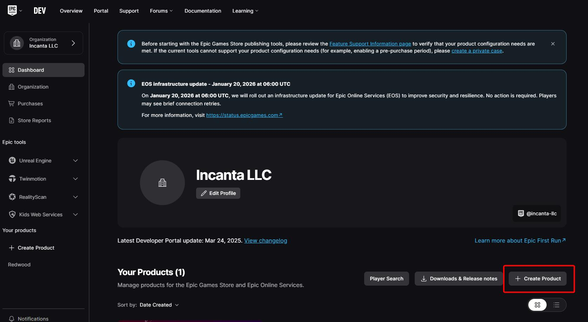
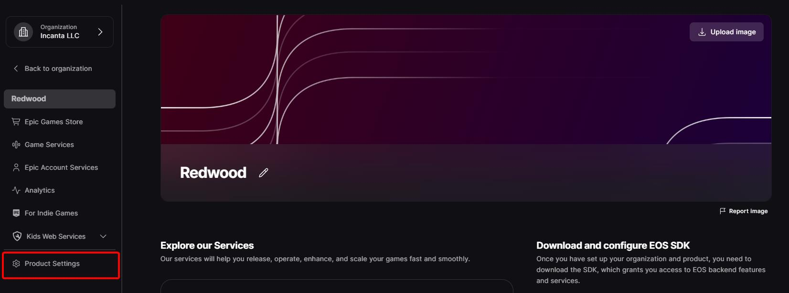
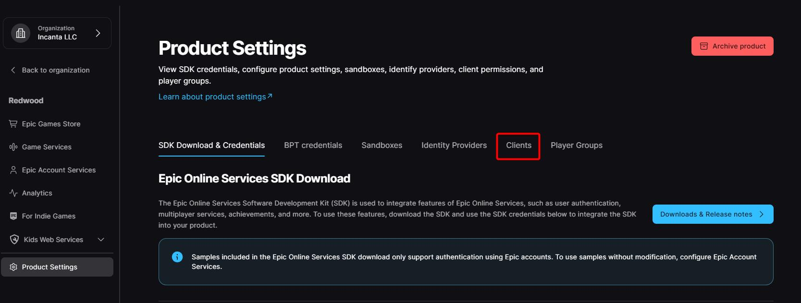
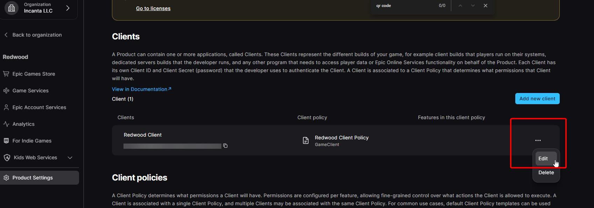
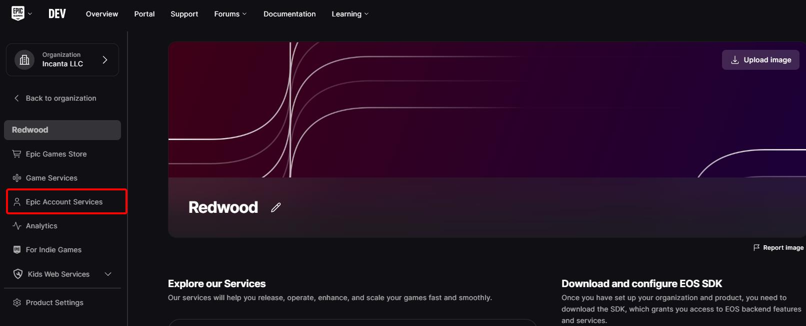
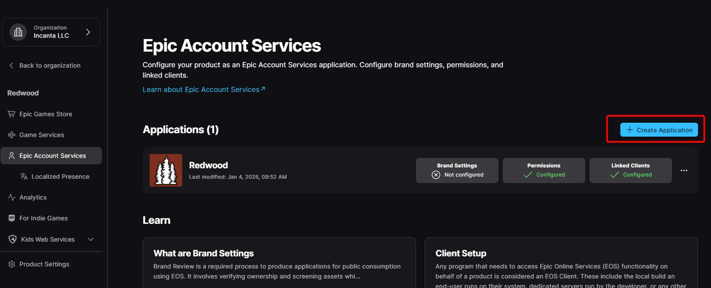
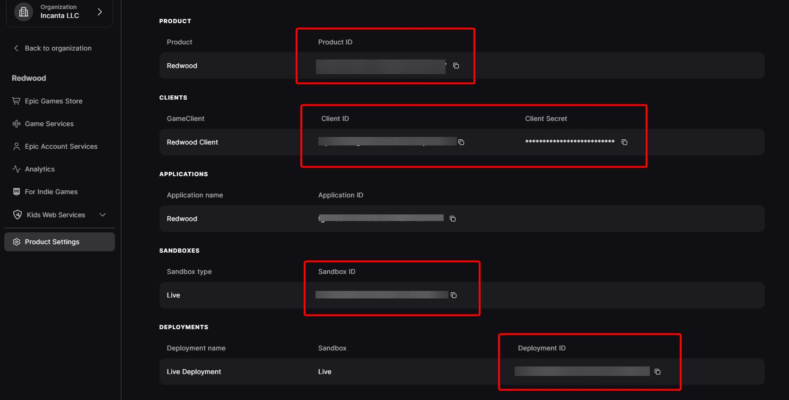
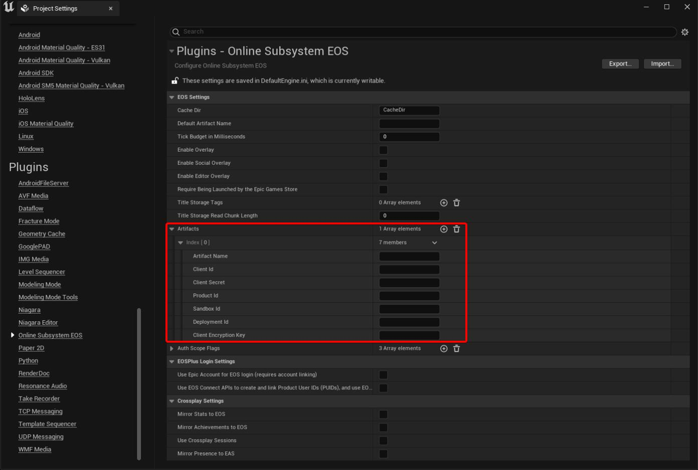

# Epic Account Services Authentication

The `epic` provider uses Epic Account Services (EAS, a part of Epic Online Services). You do not need to use any other part of EOS to use this provider. This provider can be used to manually prompt the user to log in with Epic, or to automatically log in with Epic if they launched the game via the Epic Games Launcher.

How it works:

1. The player logs in to EOS with the Unreal EOS online subsystem (the `RedwoodEOS` plugin has helpers for this)
1. The plugin gets the player's EAS auth token and logs in to the Director with the provider `epic`
1. The Director verifies the token's signature with Epic's public keys and logs the player in (creating their account on first login)

The player's Redwood username is their Epic account ID, and their nickname is set to their Epic display name (refreshed on every login).

## Configuration

Add `epic` to `auth.allowed-providers`, for example in `config/node/your-game/auth.yaml`:

```yaml
allowed-providers:
  - "epic"
```

There are no other backend config variables for this provider.

## Setup

### Epic Dev Portal

1. Sign in to the [Epic Dev Portal](https://dev.epicgames.com/portal)
1. Create or select an organization
1. Under the **Dashboard** for that organization, click **+ Create Product**

    

1. Under the dashboard for the _product_, click **Product Settings**

    

1. Click on the **Clients** tab

    

1. Scroll down and click **Add new client**
1. Give it a Client Name (e.g. `YourGame Game Client`)
1. Under the Client Policy dropdown, click **Create a new client policy**
1. Give the policy a name (e.g. `YourGame Client Policy`)
1. Select `GameClient` for the **Client policy type**
1. Click **Add new client policy**
1. You should be back in the **Add new client** modal; make sure the new client policy is selected in the dropdown
1. You can leave the **Trusted Server** IP allow list empty
1. You can leave the **Redirect URL** empty
1. Click **Add new client** to save the changes
1. Edit the client you just created

    

1. Click **Epic Account Services** in the sidebar

    

1. Click **+ Create Application**

    

1. Fill out the application's details. Under **Permissions**, you only need **Basic Profile** (it's required anyway). Under **Linked Clients**, select the client you just created.
1. Click **Save changes**

### Unreal

1. Go to the **Product Settings** page in the Dev Portal and copy the **Product ID**, **Client ID**, **Client Secret**, **Sandbox ID**, and **Deployment ID**. In Unreal's **Project Settings > Online Subsystem EOS**, add a new **Artifact** with those values and a name (e.g. your game's name), and set the **Default Artifact Name** to the same name.

    

    

1. Enable the `RedwoodEOS` plugin by manually adding it to your `.uproject` file or via `Edit > Plugins`
1. Update your UE project's `Config/DefaultEngine.ini` to enable the EOS online subsystem, making sure that you don't enable the EOS networking settings found in other EOS setup guides. Here is what a basic config may look like (as of Jan 2026):

    ``` ini
    [/Script/OnlineSubsystemEOS.EOSSettings]
    CacheDir=CacheDir
    DefaultArtifactName=GameName
    RTCBackgroundMode=
    TickBudgetInMilliseconds=0
    bEnableOverlay=False
    bEnableSocialOverlay=False
    bEnableEditorOverlay=False
    bPreferPersistentAuth=False
    TitleStorageReadChunkLength=0
    +Artifacts=(ArtifactName="GameName",ClientId="***",ClientSecret="***",ProductId="***",SandboxId="***",DeploymentId="***",ClientEncryptionKey="")
    -AuthScopeFlags=BasicProfile
    -AuthScopeFlags=FriendsList
    -AuthScopeFlags=Presence
    bUseEAS=True
    bUseEOSConnect=False
    bMirrorStatsToEOS=False
    bMirrorAchievementsToEOS=False
    bUseEOSSessions=False
    bMirrorPresenceToEAS=False
    SteamTokenType=Session

    [OnlineSubsystemEOS]
    bEnabled=true

    [OnlineSubsystem]
    DefaultPlatformService=EOS
    ```

    :::warning
    **DO NOT** change the NetDriver or enable EOS P2P sockets as other guides on setting up EOS with Unreal suggest. Redwood game servers are reached by IP address with the normal IP net driver.
    :::

### Logging in to EOS

Before logging in to Redwood, the player must be logged in to EOS. The plugin provides a few helpers on `URedwoodEOSClientInterface`:

- `LoginEOS_DevAuthTool(Endpoint = "localhost:6300", CredentialName = "Context_1")`
    - The EOS SDK download (found under your organization **Dashboard** via **Downloads & Release notes**, historically in `SDK/Tools` after unzipping) includes a developer authentication tool. Start it, pick a port (defaults to `6300`), then click **Login** to add a credential: log in with a real Epic Games account and enter a credential name. Redwood defaults to `Context_1`, but you can use something else. While the tool is running, calling this function authenticates you with EOS. This is the easiest option during development.
- `LoginEOS_PromptAccountPortal()`
    - The most cross-platform method: opens the Epic account portal (in the browser or overlay) for the player to log in.
- `LoginEOS_EpicGamesLauncher()`
    - Intended for games launched by the Epic Games Launcher in production.
- You can also "auto login" without calling any of these for packaged games launched by the Epic Games Launcher by following the official [docs](https://dev.epicgames.com/documentation/en-us/unreal-engine/online-subsystem-eos-plugin-in-unreal-engine#auto-login-with-oss-eos).

These helpers return `true` when the EOS login **started**, not when it finished. The EOS login completes asynchronously, so wait for it before calling `LoginWithEOS`: bind the online subsystem identity interface's `OnLoginComplete` delegate, or poll the login status (e.g. retry `LoginWithEOS` after a short delay; it immediately returns an `Error` with `You must be logged in to EOS before calling ...` if the EOS login hasn't finished).

:::caution Known issue (5.0.0)
`LoginEOS_EpicGamesLauncher` doesn't pass the launcher's exchange code to EOS, so it's unlikely to work. For launcher builds, use the online subsystem's auto login linked above instead.
:::

### Logging in to Redwood

Update your project to use `LoginWithEOS` instead of the normal `Login`. It has the same `FRedwoodAuthUpdate` output as `Login`, so the rest of your [login flow](../../getting-started/building-the-main-menu.md#2-log-in-or-register) stays the same. Add the `RedwoodEOS` module to your `.Build.cs` file, include `RedwoodClientGameSubsystem.h`, `RedwoodClientInterface.h`, and `RedwoodEOSClientInterface.h`, and call:

``` c++
URedwoodClientInterface* ClientInterface =
  GetGameInstance()->GetSubsystem<URedwoodClientGameSubsystem>()->GetClientInterface();

URedwoodEOSClientInterface::LoginWithEOS(
  ClientInterface,
  FRedwoodAuthUpdateDelegate::CreateWeakLambda(
    this, [this](const FRedwoodAuthUpdate& Update) {
      if (Update.Type == ERedwoodAuthUpdateType::Success) {
        // continue to the realm
      }
    }));
```

`GetClientInterface()` returns `nullptr` when [running without the backend](../../getting-started/running-without-backend.md) in PIE, so only call this when the backend is in use.

:::caution Known issue (5.0.0)
If the plugin can't get the EAS token from EOS after the EOS login, it only logs an error and the `LoginWithEOS` callback never fires. Add your own timeout to your login UI.
:::
