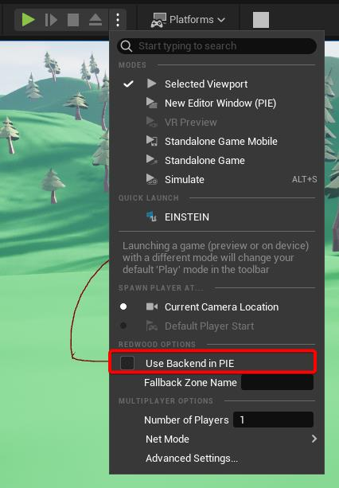
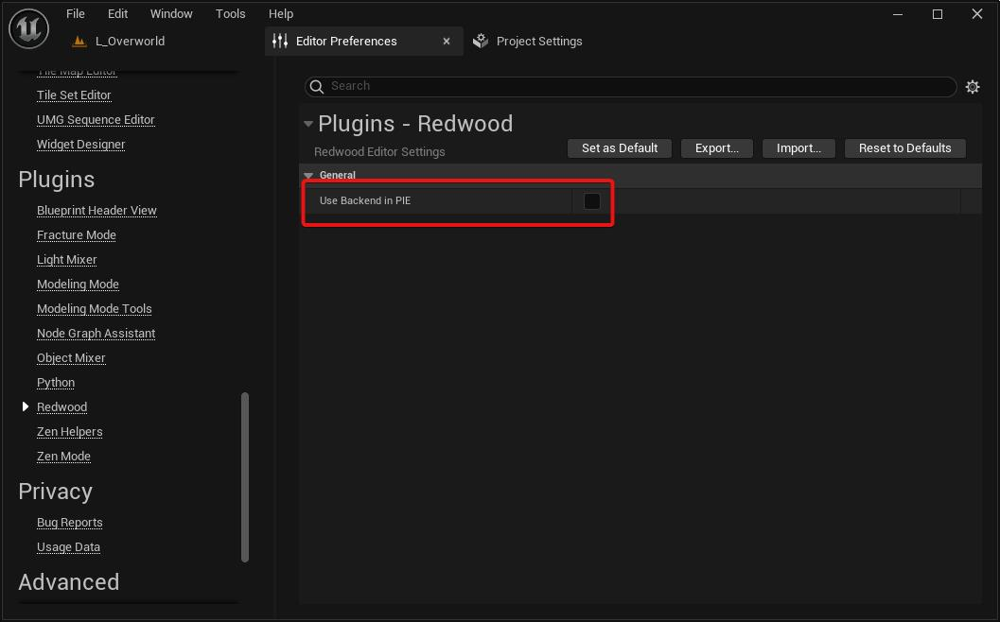

# Running without the Backend

[Running with the backend](./running-with-backend.md) is the easiest way to test [matchmaking](../features/ticketing/overview.md), [queuing](../features/ticketing/queuing.md), [sharding](../features/game-servers/sharding.md), [instanced dungeons](../features/instanced-dungeons.md), and other backend features, but it's a slow loop for everyday gameplay work: every change means waiting for an uncooked server to start.

If you're working on gameplay that only needs [character data](./saving-player-data.md) and/or [world data](../features/data/game/world-data.md), Redwood can run Play-In-Editor sessions with no backend at all. Character and world data are read from and written to JSON files in your project's `Saved/Persistence` folder instead, and every other Redwood call returns a stubbed response.

## Editor Preferences

Disable the **Use Backend in PIE** setting, found in either the **Play** button's dropdown (under **Redwood Options**) or **Edit > Editor Preferences > Plugins > Redwood**:

This only affects Play-In-Editor. **Standalone Game** launches and packaged builds always use the backend.

## Creating Characters

Each PIE client plays as a character from a JSON file, so you need to create them first:

1. Open your title map and set the **Net Mode** to **Play Standalone**.
1. Press **Play** and go through your menu. Connecting and **Login** succeed immediately with any input (**Register** returns an error in this mode, so just log in). **List Realms** returns a single fake realm, and connecting to it succeeds.
1. Create a character like you normally would. You should now see `YourProject/Saved/Persistence/Characters/000.json`.
1. Don't try to matchmake, queue, or join a lobby (those return an error in this mode); just quit PIE.

Create one character for each simultaneous client you want to test with. They're numbered in the order you create them (`000.json`, `001.json`, and so on).

:::tip
The character files are plain JSON, so you can edit them by hand to set up a test scenario (e.g. give yourself a full inventory). Each field matches one of the [character fields](./saving-player-data.md#how-it-works), using your struct's variable names (with the first letter lowercased).
:::

## Running the Game

Now open the gameplay map you're working on (e.g. `L_Arena` or `L_Overworld`), set the **Net Mode** to **Play as Client** (or **Play as Listen Server**), choose the **Number of Players**, and press **Play**.

The first client that joins the PIE server gets the first character file, the second gets the second, and so on. Each one's data is loaded into their Pawn exactly as if it came from the backend, and the server saves changes back to the same files every `DatabasePersistenceInterval`.

If your map has multiple [zones](../features/game-servers/zones.md), set **Fallback Zone Name** in the Redwood editor preferences to the zone you want to test, so players spawn at that zone's [Zone Spawns](./setting-up-unreal.md#zone-spawns). Otherwise players spawn at your Player Starts.

## What Works Without the Backend

| Feature | Without the backend |
| --- | --- |
| Login, realms, and character creation in the menu | Stubbed: always succeeds (except **Register**) |
| Character data loading and saving | Works, using `Saved/Persistence/Characters/*.json` |
| [World data](../features/data/game/world-data.md) and [zone data](../features/data/game/zone-data.md) | Works, using `Saved/Persistence/Maps/<map>.json` |
| Matchmaking, queuing, lobbies, and parties | Return an error |
| Friends, guilds, realm contacts, and global data | Return an error (or never respond, for global data) |
| [Sync Items](../features/sync-items.md) between servers | Not synchronized (there's only one server) |
| Zone transfers | Don't work |
| [Blob storage](../features/data/storage/blob-storage.md) and SaveGame nodes | Don't call these without the backend |

:::caution Known issue (5.0.0)
In this mode, a character's last location and any persistent [Sync Items](../features/sync-items.md) are saved to the JSON files but aren't loaded back, so players always start at a spawn point and persistent items don't reappear. Archiving and renaming characters also don't persist.
:::

## Debugging a Server in PIE with the Backend

Sometimes you want the real backend but need to debug the server in the editor (breakpoints, live Blueprint debugging). The `dev-debug` [game server provider](../features/game-servers/hosting/local.md) is meant for this: instead of launching `UnrealEditor.exe -server`, the backend expects you to start the server yourself in PIE (**Play as Client** with **Use Backend in PIE** enabled), and the PIE server connects to the backend's sidecar on port `3020`. It requires `environment.development: true` (the default) and characters that already exist in the realm's database. See the [hosting docs](../features/game-servers/hosting/local.md) for the details.

:::success
That's it! You can now do most of your gameplay development without waiting on the backend, and switch back to it when you're testing the full loop. Next up, [what to tackle next](./next-steps.md).
:::
