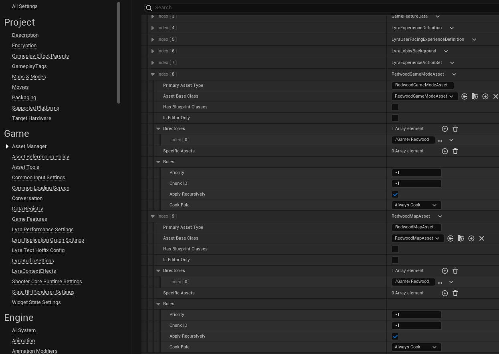

import Tabs from '@theme/Tabs';
import TabItem from '@theme/TabItem';

# Setting Up Unreal

This page takes an Unreal project (new or existing) and does the one-time setup every Redwood game needs: enabling the plugins, pointing the game at the backend, setting up your maps, wiring Redwood into your game framework classes, and registering your game modes and maps with Redwood.

:::note
We use C++ class names throughout, but everything on this page can be done in Blueprints with the equivalent classes and nodes. Where something is C++-only, we'll say so.
:::

By the end, your project will have:

| What | Why |
| --- | --- |
| The `RedwoodCore` plugin enabled | Provides all of the Redwood functionality |
| Project Settings pointing at the Director | So the client knows where to connect |
| An idle server map | Dedicated servers wait here until the backend tells them which map to load |
| Game modes that inherit from Redwood's | Redwood authenticates players and loads their data in the game mode |
| Redwood components on your Game State, Player State, and Pawn | Server details, player/character data, and persistence |
| Game Mode and Map Data Assets registered with the Asset Manager | How the backend's profile and map IDs map to your Unreal classes and levels |

## Enable the Plugins

1. Make sure the plugins are in your project's `Plugins` folder (see [Installing](./installing.md#unreal-plugins)).
1. Open your project and go to **Edit > Plugins**. Search for **Redwood** and enable **Redwood MMO Framework** (`RedwoodCore`). Enable any of the optional plugins you plan to use (`RedwoodChat`, `RedwoodSteam`, `RedwoodEOS`, or `RedwoodGAS`); you can always enable them later.
1. Restart the editor when prompted. Unreal will ask to rebuild the plugin modules; say yes (or build from your IDE).

If you prefer editing the `.uproject` directly, add the plugins to the `Plugins` array:

```json
{
  "Plugins": [
    { "Name": "RedwoodCore", "Enabled": true }
  ]
}
```

`RedwoodCore` automatically enables its dependencies (`SocketIOClient`, `LatencyChecker`, and `GameplayMessageRouter`), which ship in the `ThirdParty` folder of the plugins download.

:::info Supported platforms
`RedwoodCore` supports Windows, Linux, and macOS (clients and servers), on Unreal Engine 5.4 and newer.
:::

### C++ Module Dependencies

If you reference Redwood classes or types from C++, add the `Redwood` module to your game module's `Build.cs`. You'll usually want the JSON helpers too, since much of the API passes `USIOJsonObject` objects:

```csharp
PublicDependencyModuleNames.AddRange(new string[] {
  "Core", "CoreUObject", "Engine", "InputCore",
  "Redwood",     // RedwoodCore
  "SIOJson",     // USIOJsonObject and USIOJLibrary
});
```

The optional plugins have their own modules (e.g. `RedwoodChat` and `RedwoodXMPP` for chat); see the [Unreal Plugin Reference](../unreal-reference/overview.md) for the full list.

### Build Targets

Dedicated servers require a **Server** target. If your project doesn't have one yet, add a `<YourProject>Server.Target.cs` next to your other targets in `Source/`:

```csharp
using UnrealBuildTool;
using System.Collections.Generic;

public class YourProjectServerTarget : TargetRules
{
  public YourProjectServerTarget(TargetInfo Target) : base(Target)
  {
    Type = TargetType.Server;
    DefaultBuildSettings = BuildSettingsVersion.Latest;
    IncludeOrderVersion = EngineIncludeOrderVersion.Latest;
    ExtraModuleNames.Add("YourProject");
  }
}
```

A `Client` target (`TargetType.Client`) is also recommended so you can ship a client without server code. You don't need either target for local development (the backend runs your servers through the editor executable), but you'll need the Server target to [package servers](../deploying-to-kubernetes/packaging.md), and packaging a Server target requires an Unreal source build.

## Project Settings

Open **Edit > Project Settings > Plugins > Redwood**. The defaults are fine for local development, but here's what they mean:

| Setting | Default | What it does |
| --- | --- | --- |
| **Director Uri** | `ws://localhost:3001` | Where the game client connects to the Director. For local development either `ws://localhost:3001` or `ws://director.localhost:3001` works. For deployed environments this becomes something like `wss://director.yourgame.com`. |
| **Auto Connect to Servers** | `true` | When the backend assigns the player a server (matchmaking, lobbies, queues, zone transfers, or following their party), the client automatically travels there. If you turn this off, bind `OnRequestToJoinServer` and run the console command yourself (handy for loading screens). |
| **Servers Auto Connect to Sidecar** | `true` | Dedicated servers connect to the [sidecar](../architecture/overview.md#sidecar) on startup. Leave this on; without it players can't be authenticated. |
| **Redwood Json Enabled** | `true` | Lets a `redwood.json` file next to the packaged game override the **Director Uri** (e.g. `{ "directorUri": "wss://director.example.com" }`), so one build can point at different environments. |
| **Public Signing Key** | empty | If set, `redwood.json` overrides must be signed with the matching private key (`yarn sign-redwood-json` in the backend). |
| **Ping Attempts / Ping Timeout / Ping Frequency** | `3` / `3` s / `10` s | How the client measures latency to each region for matchmaking. |

These save to `Config/DefaultProjectSettings.ini` under `[/Script/Redwood.RedwoodSettings]`. Every setting is described in the [settings reference](../unreal-reference/settings.md).

## Editor Preferences

Redwood can run Play-In-Editor sessions with or without the backend. Open **Edit > Editor Preferences > Plugins > Redwood** (also available in the **Play** button's dropdown under **Redwood Options**):

| Setting | Default | What it does |
| --- | --- | --- |
| **Use Backend in PIE** | `false` | When enabled, PIE clients talk to the real backend (the Dev Initiator). When disabled, every Redwood call is stubbed and character/world data is stored in JSON files in `Saved/Persistence`. |
| **Fallback Zone Name** | empty | When not using the backend, which zone's [spawn points](#zone-spawns) to use. |

**Turn on Use Backend in PIE now.** We'll use the backend for the next few pages, and we'll come back to the no-backend workflow in [Running without the Backend](./running-without-backend.md).

:::note
This is a per-user preference (saved in your `Saved/Config` folder), so each person on your team sets it themselves. If you want a project-wide default, add this to `Config/DefaultEditorPerProjectUserSettings.ini`:

```ini
[/Script/RedwoodEditor.RedwoodEditorSettings]
bUseBackendInPIE=True
```
:::

## Maps

Redwood games typically use at least three kinds of maps:

| Map | Example | Used by | Purpose |
| --- | --- | --- | --- |
| Title/frontend map | `L_Title` | Clients | Login, character selection, and choosing what to play. Set as the **Game Default Map**. |
| Idle server map | `L_Empty` | Dedicated servers | A completely empty level that servers boot into. Redwood reports the server as ready and then the backend tells it which map and game mode to load. Set as the **Server Default Map**. |
| Gameplay maps | `L_Arena`, `L_Overworld` | Dedicated servers (and clients once they join) | Where the game happens. Referenced by [Map Data Assets](#map-assets). |

1. Create an empty level (**File > New Level > Empty Level**) and save it as something like `/Game/Maps/L_Empty`.
1. In **Project Settings > Project > Maps & Modes**, set **Server Default Map** to your idle map and **Game Default Map** to your title map (we'll build the title screen in [Building the Main Menu](./building-the-main-menu.md); an empty level with a widget is enough to start).

:::tip
The idle map matters more than it looks. Servers boot it with whatever game mode it's configured with, so keep it empty and use a plain game mode (not one of your Redwood game modes) in its **World Settings** to avoid running gameplay logic before the real map loads.
:::

## Game Framework Classes

Redwood plugs into the standard Unreal gameplay framework. Make these changes to the classes your **gameplay** maps use (the title map can keep using plain engine classes).

### Game Mode

Every game mode that the backend will load must inherit from one of Redwood's game modes:

| If your game mode inherits from | Change it to inherit from |
| --- | --- |
| `AGameModeBase` | `ARedwoodGameModeBase` |
| `AGameMode` | `ARedwoodGameMode` |

Change the parent class and include `RedwoodGameModeBase.h` or `RedwoodGameMode.h`.

These classes behave exactly like their engine parents in Standalone and PIE-without-backend, but on dedicated servers they:

- Verify each joining player with the backend (using a one-time token the client passes in the join URL) and kick anyone who doesn't check out
- Hold off spawning the player's pawn until their character data has loaded
- Spawn players at their last saved location, or at a [Zone Spawn](#zone-spawns)
- Periodically save character and world data (every `DatabasePersistenceInterval` seconds, `0.5` by default)

:::info Can't change your game mode's parent class?
This is required; the Game Mode Data Asset only accepts subclasses of the two Redwood classes. If your game mode comes from a framework or plugin (for example Lyra's `ModularGameplayActors` plugin), reparent the framework's base classes instead. For Lyra that means changing `AModularGameModeBase` to inherit from `ARedwoodGameModeBase` and `AModularGameMode` from `ARedwoodGameMode` in your copy of the `ModularGameplayActors` plugin, and adding the components below to the modular Game State and Player State classes.

Lyra's dedicated servers also try to pick an experience as soon as they boot (`ALyraGameMode::TryDedicatedServerLogin`). Make that return early on dedicated servers so the server idles until Redwood loads the map, and pass the experience name through your [game profile's `data`](../configuration/game-modes-and-maps.md#profiles) (e.g. `Experience: "B_ShooterGame_Elimination"`), which Redwood adds to the map URL as `?Experience=...`.
:::

### Game State

Add a **Redwood Game State Component** (`URedwoodGameStateComponent`) to your Game State class. It replicates the server's details (realm, proxy, zone, and shard) to clients, which is how clients know where they are. You can read them with `GetServerDetails()` and bind `OnServerDetailsChanged`.

### Player State

Add a **Redwood Player State Component** (`URedwoodPlayerStateComponent`) to your Player State class. This is where Redwood stores the authenticated player's data (`RedwoodPlayer`) and their character's data (`RedwoodCharacter`) on the server, and it gates pawn spawning until that data has loaded.

In the component's details panel, enable **Component Replicates**. The component uses a client RPC to tell the owning player when they're [transferring zones](../features/game-servers/zones.md), which only works on a replicated component.

:::note
`ARedwoodPlayerState` still exists for older projects but is deprecated. Use the component on your own Player State instead.
:::

### Pawn

If you want Redwood to persist your character's data (you almost certainly do), you'll add a **Redwood Character Component** (`URedwoodCharacterComponent`) to your Pawn or Character class. That needs a bit more setup, so we've given it its own page: [Saving Player Data](./saving-player-data.md). Hold off on adding it until then.

:::warning
If you add a `URedwoodCharacterComponent` without setting up its data variables, players will be kicked when they join a server ("Could not load player character data"). Follow the [Saving Player Data](./saving-player-data.md) page when you add it.
:::

## Game Mode and Map Assets

The backend refers to game modes and maps by string IDs in its [game profiles](../configuration/game-modes-and-maps.md#profiles) (the `game.yaml` you wrote in [Installing](./installing.md#initial-configuration)). When the backend starts a server, it sends the server a game mode ID and a map ID, and Redwood looks them up in two kinds of Data Assets.

Create the assets in the Content Browser with **Right Click > Miscellaneous > Data Asset**, picking the class. We recommend keeping them all in one folder (e.g. `/Game/Redwood`).

### Game Mode Assets

Create one `RedwoodGameModeAsset` per game profile:

| Property | What to set it to |
| --- | --- |
| **Redwood Id** | The profile's `id` from `game.yaml` (e.g. `deathmatch`). Lowercase, no spaces, unique. |
| **Game Mode Type** | `Game Mode Base` or `Game Mode`, matching which Redwood class your game mode inherits from |
| **Game Mode Base Class** / **Game Mode Class** | Your game mode class (the field shown depends on **Game Mode Type**) |
| **Show in Front End**, **Display Name**, **Display Description**, **Display Icon** | Optional. Redwood doesn't use these; they're there for your menus (e.g. a mode picker when hosting a lobby). |

You can point multiple Game Mode Assets at the same game mode class (e.g. an `overworld` profile and a `dungeon` profile that share one game mode).

### Map Assets

Create one `RedwoodMapAsset` per gameplay map:

| Property | What to set it to |
| --- | --- |
| **Redwood Id** | The map ID used in a profile zone's `maps` list in `game.yaml` (e.g. `arena`). Lowercase, no spaces, unique. |
| **Map Id** | The level to load. The picker lists levels known to the Asset Manager's `Map` type (by default everything under `/Game/Maps`). |
| **Map Name** | Optional display name for your menus |

### Asset Manager

Redwood finds these assets through the Asset Manager, so you need to register their types. **If you skip this, servers will never finish starting** (the server logs an error and never connects to its sidecar).

1. Open **Edit > Project Settings > Game > Asset Manager**.
1. Under **Primary Asset Types to Scan**, add an entry for each Redwood asset type:

    | Primary Asset Type | Asset Base Class | Has Blueprint Classes | Is Editor Only | Directories | Cook Rule |
    | --- | --- | --- | --- | --- | --- |
    | `RedwoodGameModeAsset` | `RedwoodGameModeAsset` | `false` | `false` | the folder with your Data Assets | `Always Cook` |
    | `RedwoodMapAsset` | `RedwoodMapAsset` | `false` | `false` | the folder with your Data Assets | `Always Cook` |
    | `RedwoodSyncItemAsset` | `RedwoodSyncItemAsset` | `false` | `false` | the folder with your Data Assets | `Always Cook` |

    The `RedwoodSyncItemAsset` type is only needed if you use [world data or Sync Items](../features/sync-items.md), but it doesn't hurt to add it now.

1. Make sure the default `Map` entry still exists (it's what the **Map Id** picker uses). If your levels aren't under `/Game/Maps`, add their folders to it.



These settings are saved in `Config/DefaultGame.ini`. If you'd rather add them directly, this is the equivalent (change the `Path` to your folder):

```ini
[/Script/Engine.AssetManagerSettings]
+PrimaryAssetTypesToScan=(PrimaryAssetType="RedwoodGameModeAsset",AssetBaseClass="/Script/Redwood.RedwoodGameModeAsset",bHasBlueprintClasses=False,bIsEditorOnly=False,Directories=((Path="/Game/Redwood")),SpecificAssets=,Rules=(Priority=-1,ChunkId=-1,bApplyRecursively=True,CookRule=AlwaysCook))
+PrimaryAssetTypesToScan=(PrimaryAssetType="RedwoodMapAsset",AssetBaseClass="/Script/Redwood.RedwoodMapAsset",bHasBlueprintClasses=False,bIsEditorOnly=False,Directories=((Path="/Game/Redwood")),SpecificAssets=,Rules=(Priority=-1,ChunkId=-1,bApplyRecursively=True,CookRule=AlwaysCook))
+PrimaryAssetTypesToScan=(PrimaryAssetType="RedwoodSyncItemAsset",AssetBaseClass="/Script/Redwood.RedwoodSyncItemAsset",bHasBlueprintClasses=False,bIsEditorOnly=False,Directories=((Path="/Game/Redwood")),SpecificAssets=,Rules=(Priority=-1,ChunkId=-1,bApplyRecursively=True,CookRule=AlwaysCook))
```

:::warning Packaging
Cooking the Map Data Assets doesn't cook the levels they point to. When you get to [packaging](../deploying-to-kubernetes/packaging.md), make sure every gameplay map, your idle server map, and your title map are in **Project Settings > Packaging > List of maps to include in a packaged build** (or are otherwise cooked).
:::

:::note
The Data Asset classes aren't exported from the `Redwood` module, so you can't reference `URedwoodGameModeAsset`, `URedwoodMapAsset`, or `URedwoodSyncItemAsset` from your own C++ code. You don't need to; Redwood loads them itself.
:::

## Zone Spawns

Every [zone](../features/game-servers/zones.md) needs to know where to put players who don't have a saved location yet. Redwood picks the spawn point in this order:

1. The character's last saved location, if it was in this zone
1. An `ARedwoodZoneSpawn` actor in the level whose **Zone Name** matches the server's zone and whose **Spawn Name** is `default`
1. Any `ARedwoodZoneSpawn` for the zone
1. Unreal's normal Player Start logic

For a simple single-zone game, normal Player Starts are fine. For anything with multiple zones (or multiple entry points into a zone), place **Redwood Zone Spawn** actors in your level:

| Property | Meaning |
| --- | --- |
| **Zone Name** | The zone key from `game.yaml` (e.g. `main` or `town`) |
| **Spawn Name** | `default` for the normal entry point; other names for specific entrances (used when [traveling between zones](../features/game-servers/zones.md)) |
| **Spawn Radius** | Randomly offset players within this radius so they don't stack |
| **Randomize Rotation** | Give each player a random yaw |

Redwood traces down from the spawn point to find the ground, so you don't need to place it precisely on the floor.

## Checklist

Before moving on, double check:

- [ ] `RedwoodCore` is enabled and the project compiles
- [ ] **Use Backend in PIE** is on
- [ ] **Server Default Map** is an empty idle level, and **Game Default Map** is your title level
- [ ] Every gameplay game mode inherits from `ARedwoodGameModeBase` or `ARedwoodGameMode`
- [ ] Your Game State has a `URedwoodGameStateComponent`
- [ ] Your Player State has a `URedwoodPlayerStateComponent` with **Component Replicates** enabled
- [ ] There's a `RedwoodGameModeAsset` for every profile `id` in `game.yaml`, and a `RedwoodMapAsset` for every map ID in its zones
- [ ] The Asset Manager scans `RedwoodGameModeAsset`, `RedwoodMapAsset`, and `RedwoodSyncItemAsset` with **Always Cook**

:::success
Your project is ready to talk to Redwood. Next, let's **[build the main menu](./building-the-main-menu.md)** so players can log in and join a server.
:::
